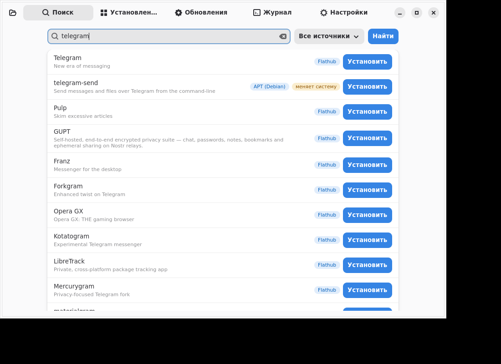

# Ставилка

Установщик любых Linux‑программ: внутри себя и через контекстное меню файлового менеджера. Интерфейс на русском (GTK4 + libadwaita). В первую очередь рассчитан на **Debian 13 (trixie)**.



## Возможности
- **Единый поиск** по Flathub (Flatpak), APT (основной), Snap, а также dnf / pacman / zypper (на соответствующих дистрибутивах). У каждого результата есть метка источника. Пакеты APT/RPM/pacman помечены **«меняет систему»**.
- Установка, удаление и обновление. Вкладки «Установленные», «Обновления» и «Журнал» (там видно полный вывод команд).
- **Локальные файлы** (перетаскивание, «Открыть», контекстное меню, `stavilka файл`):
  - `.AppImage` ставится в `~/.local/share/stavilka/apps`, получает ярлык в меню и иконку;
  - `.tar.gz/.tar.xz/.tar.bz2/.zip` распаковываются в `~/.local`, ярлык находится или создаётся;
  - `.deb` (через apt, с симуляцией), `.rpm` (только на RPM‑системах), `.flatpakref`, `.flatpak`;
  - `.sh` запускается **без root**, только после подтверждения.
- **Контекстное меню** «Установить через Ставилку» в Nautilus (nautilus‑python или Scripts), Dolphin, Nemo, Caja и Thunar. Также есть пункт «Открыть с помощью».
- **Фоновая проверка обновлений** при входе: одно уведомление, затем программа завершается. Демона нет.
- Настройка Flathub для пользователя в один клик.

## Установка
**AppImage (основной способ, без установки):**
```
chmod +x Stavilka-1.0.0-x86_64.AppImage && ./Stavilka-1.0.0-x86_64.AppImage
```
При первом запуске программа предложит интеграцию: пункт меню, контекстное меню и автозапуск. Можно выбрать «Без автозапуска» или «Не сейчас».
Нужны системные `python3-gi`, `gir1.2-gtk-4.0` и `gir1.2-adw-1`; в Debian 13 GNOME/KDE они обычно уже стоят. Без FUSE запускайте с `APPIMAGE_EXTRACT_AND_RUN=1`; ярлык интеграции делает это сам.

**Скрипт (только в домашний каталог, без root):** `./install.sh Stavilka-1.0.0-x86_64.AppImage`

**.deb:** `sudo apt install ./stavilka_1.0.0_all.deb`, затем `stavilka --integrate` от пользователя. В пакете нет maintainer‑скриптов.

## Гарантии безопасности
1. Программа **никогда не трогает** загрузчик, ядро, initramfs, systemd‑юниты, экранный менеджер и системные конфиги. Сама она ничего не пишет в `/etc` и `/usr`.
2. **Автозапуск** работает только через `~/.config/autostart/` с задержкой 15 с, под `nice`/`ionice` и с `|| true`. Если файла нет или запуск упал, вход в систему не ломается. Системных служб нет, root при загрузке не используется.
3. **Безопасный режим:** после 2 неудачных автозапусков подряд программа сама отключает свой автозапуск.
4. Интеграция пишет файлы только в `~/.local` и `~/.config` и ведёт их список (манифест).
5. **Перед каждой установкой или удалением через apt** выполняется симуляция `apt-get -s`. Операция **отклоняется с предупреждением**, если она:
   - удалит хоть один пакет;
   - обновит или удалит критичный пакет (libc6, systemd, xorg, mesa, dbus, polkit, сеанс рабочего стола, …);
   - установит или изменит то, что влияет на загрузку: ядро, grub/shim, initramfs, драйверы nvidia, firmware, смену init, gdm/sddm/lightdm, plymouth.
   Установка идёт с `--no-remove`, обновление — с `--only-upgrade`, удаление — без purge.
6. **Никогда** не запускаются `full-upgrade`, `dist-upgrade` и `autoremove`. Частичные обновления pacman (`-Sy pkg`) запрещены.
7. По умолчанию предпочитаются Flatpak (`--user`) и AppImage. Системные пакеты требуют отдельного подтверждения со списком изменений. Права root запрашиваются через `pkexec` и только на одну конкретную команду.
8. Если установлен **Timeshift**, перед системной установкой программа предлагает снимок (это можно отключить).
9. Сторонние apt‑репозитории не добавляются. Если .deb сам добавит источник в `sources.list.d`, вы получите предупреждение.
10. **Полное удаление** («Настройки → Удалить Ставилку полностью» или `--uninstall`) убирает всё, что создала программа: ярлыки, меню, автозапуск, настройки и установленные ею AppImage. Flatpak/apt‑пакеты остаются, их удаляют во вкладке «Установленные».
11. Телеметрии нет. В сеть программа обращается только к менеджерам пакетов.

## Команды
`--integrate [--no-autostart]`, `--unintegrate`, `--uninstall`, `--background`, `--version`, `файлы…`

## Ограничения
- Окна pkexec/polkit и пункты меню в реальных Nautilus/Dolphin/Nemo/Thunar проверены только по формату файлов, без живого сеанса.
- В GTK4 нет значка в трее, поэтому фоновый режим только показывает уведомление.
- Snap поддерживается при наличии `snapd`. На Debian по умолчанию его нет.
- Установка `.rpm` на Debian и `.deb` на RPM‑системах намеренно запрещена.

## Разработка
`python3 -m pytest tests` · `packaging/build.sh /path/to/appimagetool` → `dist/`

Лицензия: MIT.
